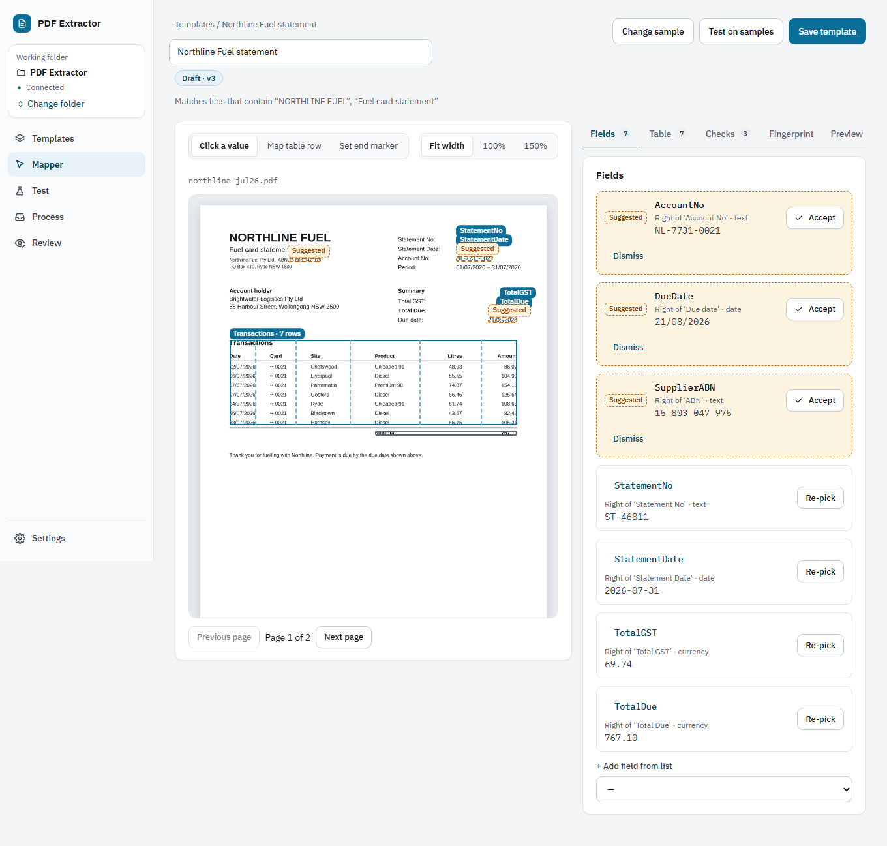
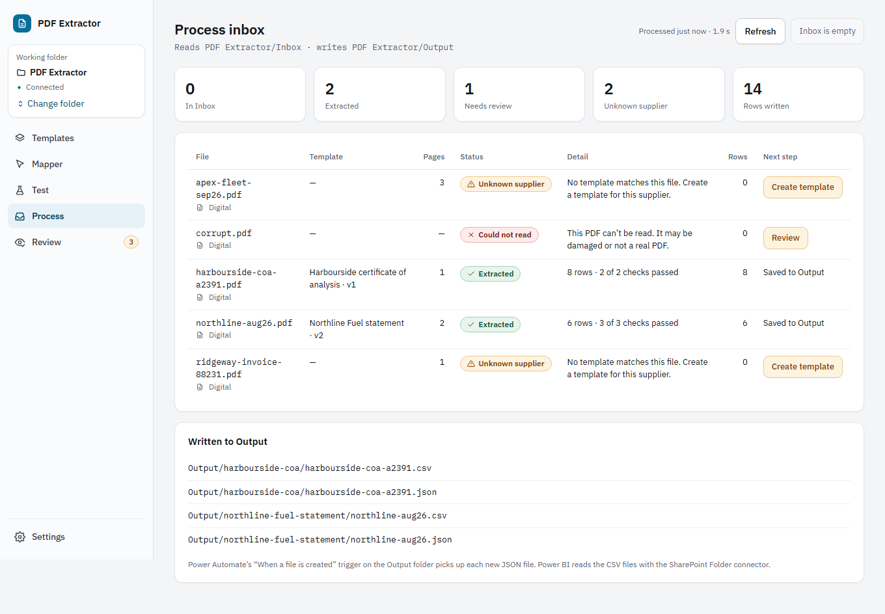

# PDF Extractor

Turn supplier PDFs (fuel card statements, phone bills, invoices, certificates of analysis) into clean, identical-every-time CSV and JSON tables. Map a supplier's layout once by clicking on a sample; every later PDF from that supplier is read the same way and checked.

It runs entirely in your browser. **Documents never leave your computer**: there's no server, no upload and no tracking.

**[Open the app](https://sadhman3-bit.github.io/pdf-extractor/)** · Works best in Chrome or Edge, with a SharePoint folder synced through OneDrive. Other browsers run a [basic mode](docs/USER_GUIDE.md#basic-mode).



## What it does

- **Map once, by clicking.** Click a value on a sample PDF; the app finds its label, works out the type and suggests a standard name. Click a table row and it finds the whole table, across pages.
- **Checks every file.** Rules such as "the amounts add up to the total" and "GST is the total ÷ 11" run on every document. Anything that doesn't add up goes to review, with the problem highlighted.
- **Reads scanned PDFs** with text recognition (OCR) that runs in the browser.
- **Works with your folder.** It processes an `Inbox` folder, writes results to `Output`, and files each PDF in `Processed` or `Exceptions`, so Power Automate and Power BI can pick the results up.
- **Keeps a record.** Every extraction, correction and approval goes into an audit log, and every template change is a new version.



## Documentation

| Document | For |
| --- | --- |
| [User guide](docs/USER_GUIDE.md) | Everyone using the app |
| [Privacy](docs/PRIVACY.md) | What happens to your documents, and what is stored where |
| [Manual setup](docs/MANUAL_SETUP.md) | Setting up the shared folder and the first supplier |
| [Manual tests](docs/MANUAL_TESTS.md) | Checks that need real Windows, OneDrive and Microsoft 365 |
| [Power Automate](docs/POWER_AUTOMATE.md) | Email to Inbox, a Teams nudge, output to a SharePoint list |
| [Power BI](docs/POWER_BI.md) | Reporting on the outputs, and matching against ERP data |
| [Template format](docs/TEMPLATE_FORMAT.md) | Reading or hand-editing templates |
| [Output format](docs/OUTPUT_FORMAT.md) | The CSV and JSON files, with the Parse JSON schema |
| [Decisions](docs/DECISIONS.md) | Choices made while building it, and measured performance |

Screenshots of every screen, in light and dark mode, are in [`docs/screenshots`](docs/screenshots).

## Developing

You need Node.js 22 and pnpm 10.

```
pnpm install
pnpm dev
```

`CONTRIBUTING.md` explains the checks every change must pass, and `AGENTS.md` lists all the commands.

## Licence

MIT, see [`LICENSE`](LICENSE). The app bundles open-source libraries, fonts and OCR data under their own licences, listed in [`THIRD_PARTY_NOTICES.md`](THIRD_PARTY_NOTICES.md).

Every company, person and number in the sample documents (`fixtures/`) is made up.

## Security

Please report vulnerabilities privately; see [`SECURITY.md`](SECURITY.md).
